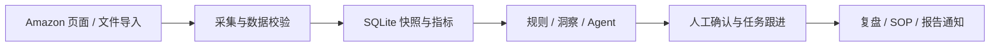

<div align="center">

<h1>Amazon Monitor</h1>

<p><strong>Amazon 关键词竞品价格与排名监控系统</strong></p>
<p>从关键词与类目采集，到竞品洞察、SKU 经营与人工确认的 AI 行动。</p>

<p>
  <a href="CHANGELOG.md"></a>
  <a href="package.json"></a>
  <a href="apps/web/package.json"></a>
  <a href="package.json"></a>
  <a href="apps/api/src/store/db.ts"></a>
  <a href="apps/desktop/package.json"></a>
</p>

<p>
  <a href="https://github.com/facron2004/amazon-monitor/actions/workflows/windows-release-verify.yml"></a>
  <a href="https://github.com/facron2004/amazon-monitor/actions/workflows/macos-arm64-package.yml"></a>
</p>

<p><strong>简体中文 · 主文档</strong></p>

<p>
  <a href="#核心功能">核心功能</a> ·
  <a href="#快速开始">快速开始</a> ·
  <a href="#配置说明">配置说明</a> ·
  <a href="#构建与桌面打包">构建与打包</a> ·
  <a href="#文档导航">文档导航</a> ·
  <a href="CHANGELOG.md">更新日志</a>
</p>

</div>

## 项目简介

Amazon Monitor 是面向 Amazon 运营团队的本地优先工作台。系统通过 Playwright 采集搜索结果和 Best Sellers 榜单，结合自营 SKU 指标、规则与 AI 建议，把每日变化转化为可跟进、可复盘的任务。

支持 Web 与 Electron 桌面运行，使用 SQLite 保存业务数据、历史快照与审计记录。关键词、类目、竞品、报告和任务按组织隔离。



## 核心功能

| 模块 | 能力 |
| --- | --- |
| 关键词监控 | 采集搜索排名、价格、Coupon、Deal、评分与评论，查看历史趋势和每日变化 |
| 类目情报 | 采集 Best Sellers Top100，生成榜单 Diff、品牌矩阵、新品黑马与价格活动雷达 |
| 竞品池 | 支持手动、CSV、BSR 与 Agent 证据候选入池，跟踪 ASIN、品牌及价格活动 |
| 自营 SKU 经营 | 按业务日期聚合销售、广告、库存、利润、Listing 与评论 VOC，提供风险和机会评分 |
| 运营行动中心 | 组织异动事件、ASIN 案卷、任务、活动排期与 SOP，记录执行和复盘结果 |
| AI Agent | 提供 7 类业务 Agent、运行审计与质量反馈，建议经人工确认后转任务 |
| 数据源与采集中心 | CSV/XLSX 导入、同步历史、行级错误、Worker 心跳、队列与数据新鲜度 |
| 报告与通知 | 日报、周报、月报归档，支持 PDF / Markdown / Excel，以及 SMTP 和飞书通知 |

### AI Agent 矩阵

| Agent | 主要用途 |
| --- | --- |
| 每日运营助理（AI Daily Operator） | 根据当日事件、开放任务与 SKU 风险整理“今日 5 件事” |
| 选品研究（Product Research） | 分析类目、品牌、价格带与候选 ASIN，生成立项验证草案 |
| 竞品分析（Competitor Analyst） | 研判竞品价格、排名、Review 与活动变化 |
| Listing 优化（Listing Optimizer） | 基于已有证据生成标题、Bullet、图片与 A+ 改写草案 |
| 广告分析（Ads Analyst） | 识别浪费、否词候选与放量机会 |
| 评论洞察（Review VOC） | 提炼评论主题、供应商整改、客服与新品机会 |
| 报告撰写（Report Writer） | 汇总经营报告、事件与待审批动作 |

桌面 Agent 还支持自然语言任务、OpenAI / OpenAI-compatible / ChatGPT OAuth 连接、只读业务工具、人工审批与事件回放。详细接口及证据规则见[功能与架构指南](docs/feature-guide.md)。

### 数据与 AI 边界

- 页面采集失败会记录原因与排查截图；缺失指标明确显示数据缺口，不生成虚构竞品或经营结果。
- 金额按站点币种统计；Agent 记录证据来源、日期和新鲜度，过期或不完整数据会降低置信度。
- 外部模型调用默认关闭，Agent 与报告摘要分别启用；业务建议需人工确认。
- SP-API 只读连接默认关闭，启用前需完成真实店铺 Shadow 对账与验收，详见[真实数据底座说明](docs/PRD_V0.7_REAL_DATA_FOUNDATION.md)。

## 快速开始

### 1. 准备环境并安装依赖

需要 **Node.js ≥ 22.12.0**、**npm ≥ 10**，以及可访问目标 Amazon 站点的网络。项目使用 Node.js 内置的 `node:sqlite`。

```bash
git clone https://github.com/facron2004/amazon-monitor.git
cd amazon-monitor
npm ci
npm run build:shared
npm run build:agent
node node_modules/playwright/cli.js install chromium
```

### 2. 按需配置环境变量

基础页面和手动采集不需要模型 Key 或邮件账号。需要通知、调度或自定义数据库路径时，将 [`.env.example`](.env.example) 复制到根目录 `.env`，再填写对应配置。

Windows PowerShell：

```powershell
if (-not (Test-Path -LiteralPath .env)) { Copy-Item -LiteralPath .env.example -Destination .env }
```

macOS / Linux：

```bash
test -f .env || cp .env.example .env
```

已有 `.env` 时直接编辑，保留原有数据库路径和账号配置。

### 3. 启动 Web、API 与 Worker

在第一个终端启动开发服务：

```bash
npm run dev
```

在第二个终端启动采集队列 Worker：

```bash
npm run worker
```

| 入口 | 默认地址 |
| --- | --- |
| Web 开发页面 | [http://127.0.0.1:5188](http://127.0.0.1:5188) |
| API 服务 | [http://127.0.0.1:4000](http://127.0.0.1:4000) |
| 就绪检查 | [http://127.0.0.1:4000/api/ready](http://127.0.0.1:4000/api/ready) |
| OpenAPI 文档 | [http://127.0.0.1:4000/api/openapi.json](http://127.0.0.1:4000/api/openapi.json) |

`npm run dev` 启动 API 与 Web，Worker 独立消费队列。Windows 完成依赖与浏览器准备后，也可使用 `start.bat` 启动 API、Web 和 Worker，使用 `stop.bat` 停止。

### 4. 完成首次使用

1. 打开 Web 页面，按初始化提示创建首个管理员并登录。
2. 在关键词或类目页添加监控配置。
3. 点击“采集当前”或“采集全部”，在采集中心查看任务与 Worker 状态。
4. 查看快照、趋势和异动，将需要跟进的事件转成任务。
5. 按需导入 SKU 指标，配置报告和通知计划。

系统不会自动填充演示数据；首次采集前的空状态属于正常情况。

## 配置说明

| 配置项 | 默认值 | 说明 |
| --- | --- | --- |
| `PORT` | `4000` | API 监听端口 |
| `DB_PATH` | `data/amazon-monitor.sqlite` | 源码运行的数据库位置；自定义相对路径按进程工作目录解析 |
| `ENABLE_CRON` | `true` | 定时采集、通知及同步调度开关 |
| `RUN_WORKER` | `false` | 是否由 API 进程启动 Worker；默认使用独立 Worker |
| `VITE_DEV_API_PROXY_TARGET` | `http://127.0.0.1:4000` | Web 开发代理目标；修改 API 端口时一并调整 |
| `AGENT_SDK_ENABLED` | `false` | 外部 Agent 模型调用开关 |
| `INSIGHT_REPORT_LLM_ENABLED` | `false` | 报告外部 AI 摘要开关 |
| `SP_API_CONNECTOR_ENABLED` | `false` | SP-API 只读连接开关 |
| `PUBLIC_BASE_URL` | 未设置 | 邮件 Dashboard 入口与飞书 Excel 下载链接的公开地址 |

`.env` 只加载服务端白名单中的配置；`VITE_*` 由 Vite 读取。模型开关、模型名称与 Key 通过进程环境变量注入，桌面模型连接在 Agent 中心配置。模板值与源码默认值的区别、SMTP、飞书、采集调优和备份用法见[部署与运维指南](docs/operations-guide.md)。

## 构建与桌面打包

构建全部工作区后，API 会托管 `apps/web/dist`：

```bash
npm run build
npm start
```

访问 [http://127.0.0.1:4000](http://127.0.0.1:4000)。需要处理队列时，另开终端运行 `node --no-warnings apps/api/dist/worker.js`。

| 目标 | 命令 |
| --- | --- |
| Windows x64 NSIS 安装器 | `npm --workspace @amazon-monitor/desktop run package:win` |
| macOS Apple Silicon DMG | `npm --workspace @amazon-monitor/desktop run package:mac:arm64` |
| Windows 安装包与运行时验收 | `npm run verify:release:win` |

桌面产物输出到 `release/electron/`。macOS 打包需要 Mac 或 macOS runner；当前工作流产出未签名 DMG。页首的两个平台徽章对应手动触发的 GitHub Actions 工作流，签名、安装、升级和恢复验收详见[发布说明](docs/operations-guide.md#构建和部署)。

## 开发与验证

| 命令 | 用途 |
| --- | --- |
| `npm run dev:api` / `npm run dev:web` | 单独启动 API / Web |
| `npm test` | 运行 shared、agent、api、web、desktop 五个工作区的单元测试 |
| `npm run test:browser` | 运行浏览器测试；缺少 Chromium 时自动安装 |
| `npm run typecheck` | 构建 shared、API 和 Web，并检查类型 |
| `npm run collect` | 直接采集全部关键词与类目 |
| `npm run collect:keyword` / `npm run collect:category` | 按类型运行 CLI 采集 |
| `npm run backup:db` | 生成经过完整性校验的 SQLite 备份 |
| `npm run verify` | 执行生产构建、类型检查、单测、浏览器测试与发布门禁 |

提交前按项目约定完成检查：

```bash
npx tsc --noEmit --project apps/api/tsconfig.json
npx vue-tsc --noEmit --project apps/web/tsconfig.json
npm test
```

编码约定、依赖方向和迁移流程见 [AGENTS.md](AGENTS.md)。API 保持 Express 4.x，数据库嵌套事务使用 SAVEPOINT。

## 项目结构

```text
amazon-monitor/
├── apps/
│   ├── api/       # Express API、采集 Pipeline、Worker 与 SQLite Store
│   ├── web/       # Vue 3 运营工作台
│   ├── agent/     # Agent 编排、工具、Workflow 与评测
│   └── desktop/   # Electron 主进程、桥接与打包
├── packages/
│   └── shared/    # 共享类型、领域模型与业务规则
├── scripts/       # 启停、数据验证与发布验收脚本
├── docs/          # 功能、运维、设计、验收与历史归档
├── data/          # 源码运行的本地数据库与采集证据
└── .github/       # Windows / macOS 手动工作流
```

`shared` 提供共享领域契约；API 与 Web 通过 HTTP 通信，Web 不直接依赖 API 源码。

## 文档导航

| 文档 | 内容 |
| --- | --- |
| [功能与架构指南](docs/feature-guide.md) | Agent 接口、SKU 经营、类目情报、组织隔离与实现结构 |
| [部署与运维指南](docs/operations-guide.md) | 构建发布、CLI、采集参数、SMTP / 飞书、备份与故障排查 |
| [环境变量模板](.env.example) | 基础服务、通知、Agent 与 SP-API 配置参考 |
| [Agent V1 验收](docs/AGENT_V1_ACCEPTANCE.md) | 运行时、工具、人工审批与桌面验收 |
| [Agent 金标评测](docs/AGENT_GOLD_EVALUATION.md) | 评测集、运行方式与质量检查 |
| [Agent OS 路线状态](docs/AGENT_OS_ROADMAP_STATUS.md) | Signal Feed、Workflow 与阶段边界 |
| [真实店铺 Shadow 对账](docs/REAL_STORE_SHADOW_RECONCILIATION.md) | SP-API 真实数据验收与证据包 |
| [架构决策](docs/adr/) · [设计参考](docs/design/README.md) | 架构选择与界面设计依据 |
| [更新日志](CHANGELOG.md) · [历史归档](docs/archive/) | 版本变化与历史过程记录 |
