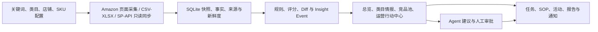

# Amazon 监控台当前开发功能说明

> 文档日期：2026-08-20
> 版本基线：`1.1.0`
> 产品：Amazon 关键词竞品价格与排名监控系统

## 1. 文档口径

本文按当前源码、`README.md`、`CHANGELOG.md` 和开发进度记录整理，描述已经进入系统实现的功能，不把 PRD 规划项直接当作已交付功能。

状态含义如下：

- **已实现**：已有前端入口、API/Store 或运行链路。
- **已实现但需配置**：代码已具备，但需要真实账号、环境变量或人工审批才能使用。
- **开发完成、待外部验收**：本地测试、fixture 或 smoke 已覆盖，但还缺真实店铺、长期运行或签名发布验收。
- **暂不在当前范围**：已明确排除，不能按当前版本功能使用。

当前工作区存在其他未提交的 API、桌面端、Web 和 shared 包改动；本说明不会把这些 WIP 回退，也不把它们单独宣称为新的正式版本。

## 2. 产品闭环



系统定位是内部 Amazon 运营工作台：把关键词/类目监控、竞品研究、自营 SKU 经营、数据质量、运营任务和 AI 辅助串成闭环。采集和同步默认不制造演示数据；缺少证据时显示数据缺口，不用 `0` 伪造经营结果。

## 3. 当前 Web 功能

前端侧栏目前分为“监控视图”“跟进视图”“系统工具”三组，共 21 个主视图。

### 3.1 监控视图

| 模块 | 当前功能 | 状态 | 主要入口 |
| --- | --- | --- | --- |
| 总览 | 当前组织的经营 KPI、今日动作、事件流、关键词健康、开放任务；支持事件状态更新、转任务和生成日报 | 已实现 | `OverviewView.vue`、`/api/dashboard/*` |
| 类目情报 | 配置 Amazon Best Sellers 类目，采集 Top100，展示 Top10/50/100 KPI、品牌矩阵、异动信息流、新品黑马、价格/Coupon/Deal 信号、完整榜单和榜单 Diff | 已实现但需采集数据 | `CategoriesView.vue`、`category-pipeline.ts` |
| 关键词 | 关键词新增、启停、优先级、采集；展示 SERP 快照、排名矩阵、排名变化、历史趋势和关键词告警 | 已实现但需采集数据 | `KeywordsView.vue`、`pipeline.ts` |
| 竞品池 | 支持手动、CSV、BSR、新品黑马和 Agent 证据候选入池；支持来源、层级、关注状态、价格/排名/Review/活动历史、每日 KPI 和趋势 | 已实现 | `CompetitorsView.vue`、`/api/competitors/*` |
| 自营 SKU | 自营商品主数据、店铺归属、日指标录入/导入、风险评分、机会评分、数据新鲜度和 SKU 详情 | 已实现 | `ProductsView.vue`、`/api/products/*` |
| SKU 360 | 以一个业务日期聚合销售、利润、广告、库存、关键词、BSR、Review VOC、Listing、竞品、Agent、任务和操作事件 | 已实现 | `ProductDetailPanel.vue`、`GET /api/products/:id/operations` |
| 库存 | 库存计划、安全库存、缺货/补货/积压/数据缺口判断；支持人工确认后转补货任务 | 已实现；SP-API 库存需额外开启 | `InventoryView.vue`、`/api/inventory/*` |
| 利润 | 成本与利润计划、四种价格情景、最低安全线和目标毛利线；支持人工确认后转价格/活动评审任务 | 已实现 | `ProfitView.vue`、`/api/profit/*` |
| Listing 健康 | 检查关键词覆盖、长度、重复、图片、Bullet、Q&A、Review 反映等 Listing 证据；支持生成改写草案 | 已实现 | `ListingHealthView.vue`、`/api/listing-health/*` |
| 广告工作流 | Ads 日指标和汇总、ACOS/ROAS/CVR、花费与预算使用率、浪费候选、否词建议、放量机会和任务转化 | 已实现；外部 Ads API 直连不属于 v0.7 范围 | `AdsView.vue`、`/api/ads/*` |
| 评论 VOC | 评论文本、情绪、主题标签、30 日聚合、供应商整改、Listing/客服/新品机会和证据缺口 | 已实现 | `ReviewVocView.vue`、`/api/review-voc/*` |

### 3.2 跟进视图

| 模块 | 当前功能 | 状态 | 主要入口 |
| --- | --- | --- | --- |
| 运营行动中心 | 按日期、优先级、状态、ASIN、品牌等筛选 Insight Event；提供 ASIN 案卷、Brand Playbook、价格时间线、归属、回顾节奏、信号流、排行榜和事件转任务 | 已实现 | `ActionCenterPanel.vue`、`/api/insight-events/*` |
| Agent 中心 | 查看运行历史、证据、数据新鲜度、置信度、工具轨迹、失败原因和建议；建议经审批后才能执行，可转任务并支持点赞/点踩和质量统计 | 已实现；真实模型需配置 | `AiAgentsView.vue`、`/api/ai/*`、`/api/agent/*` |
| Agent OS Signal Feed | 从真实 `InsightEvent(RANK_SURGE)` 展示排名异动、前后排名、证据和建议；支持幂等启动 Ranking Jump Workflow、人工审批暂停/恢复和忽略 | 已实现；需有排名 Insight Event | `AgentOsSignalFeed.vue`、`/api/agent-os/signals/*`、`ranking-jump-analysis` |
| 任务 | 任务创建、分配、备注、执行记录、前后指标、复核结论、来源证据、CSV 执行清单、团队表现和 SOP 推荐 | 已实现 | `TasksView.vue`、`/api/tasks/*` |
| 活动排期 | 按店铺/SKU 管理活动时间线，识别准备中、进行中、待复盘状态，并幂等创建准备/复盘任务 | 已实现 | `PromotionsView.vue`、`/api/promotions/*` |
| SOP 知识库 | 服务端搜索、分类/状态筛选、分页、草稿编辑、确认发布、归档；任务详情最多推荐 3 条组织内已发布 SOP，并展示命中原因 | 已实现 | `SopsView.vue`、`/api/sops/*` |

### 3.3 系统工具

| 模块 | 当前功能 | 状态 | 主要入口 |
| --- | --- | --- | --- |
| 规则中心 | 10 条 P0 规则的启停、阈值、冷却和通知渠道配置；运行规则后生成标准 Insight Event | 已实现 | `RulesView.vue`、`/api/rules/*` |
| 数据源 | 管理 SP-API、Ads API、公开采集、CSV/XLSX、ERP/WMS 和手工数据源的配置、健康状态、同步运行历史、行级错误和部分成功 | 已实现；外部连接按数据源开关 | `DataSourcesView.vue`、`/api/data-sources/*` |
| 店铺账号 | 管理组织内 Amazon 站点、Seller ID、授权状态、启停状态和 SKU 店铺归属 | 已实现 | `StoreAccountsPanel.vue`、`/api/stores/*` |
| 预警 | 查看和处理规则、排名、价格、库存、广告、Review、Listing 等运营告警 | 已实现 | `AlertsView.vue`、`/api/insights/*` |
| 报告 | 生成按日期版本化的 9 章节日报；生成周报/月报，支持多站点币种拆分、时间窗口比较、归档和数据缺口说明 | 已实现 | `ReportsView.vue`、`/api/reports/*` |
| 通知 | 创建每日计划，按 `Asia/Shanghai` 定时发送 `Amazon Intelligence Brief` HTML 邮件或飞书日报；邮件按事件流展示摘要、Critical Alerts、市场/BSR/价格/关键词变化和 Action Center 跟进，并保留 Excel 附件/链接 | 已实现但需配置真实服务 | `NotificationsView.vue`、`apps/api/src/notifications/intelligence-brief.ts`、`/api/notifications/*` |
| 采集中心 | 查看 Worker 心跳、队列、数据新鲜度、采集任务、分页执行日志和失败证据；支持按关键词/类目发起采集 | 已实现但需启动 Worker/采集器 | `CollectorsView.vue`、`/api/collectors/*` |

## 4. AI Agent 功能

### 4.1 确定性 Agent 矩阵

当前已实现 7 类业务 Agent：

1. **AI Daily Operator**：从今日事件、未关闭任务和 SKU 风险中生成“今日 5 件事”。
2. **Product Research**：从类目榜单、品牌矩阵和类目信号中分析价格带、低 Review 切入窗口和候选 ASIN。
3. **Competitor Analyst**：围绕指定事件、ASIN 和品牌信号分析竞品价格、排名、Review 与活动。
4. **Listing Optimizer**：基于 Listing、关键词、Review/Q&A 证据生成标题、Bullet、图片和 A+ 改写草案。
5. **Ads Analyst**：分析广告浪费、否词候选和放量机会。
6. **Review VOC**：分析评论情绪与主题，输出供应商、Listing、客服和新品机会。
7. **Report Writer**：基于日报/周报/月报和 Insight Event 生成 Markdown 运营报告。

所有 Agent 统一执行以下边界：

- 先检查证据日期、来源、同步时间、采集状态和失败原因；过期或不完整数据会降级置信度，并优先提出刷新动作。
- 推荐动作保留 `needs_human_approval: true`，不会直接修改商品、价格、广告、库存或活动。
- 运行输入、输出、模型、状态、错误、耗时、证据和审批动作写入组织范围内的审计记录。
- Product Research 的立项草案可在人工确认后拆成 Review VOC、利润、合规和供应链验证任务，但创建任务不等于批准立项。

### 4.2 Agent V1 / 桌面运行时

Electron 桌面端已经串联自然语言任务、确定性计划、强制新鲜度检查、15 个 Amazon 只读工具、证据化输出、行动提案、人工审批、幂等执行、SSE 事件回放和组织级审计导出。

桌面端支持：

- OpenAI API Key、OpenAI-compatible API 和 ChatGPT OAuth 多模型连接。
- Windows `safeStorage` 加密保存模型连接；凭据不进入 Renderer、SQLite 或普通日志。
- API、Agent、Crawler 三个 utility process，有限重启、运行取消和进程状态展示。
- OAuth Agent 使用只读业务工具和受限沙箱，不开放编码、插件或任意内置工具。
- 审批后的重新采集、ASIN 监控、任务创建、飞书/报告导出等动作按服务端等级和幂等键执行。

真实外部模型调用仍受 `AGENT_SDK_ENABLED`、模型连接和运行环境约束；默认配置不会因为存在通用 API Key 就自动启用全部 Agent 能力。

## 5. 数据采集与真实数据底座

### 5.1 页面采集

- 关键词采集打开 Amazon 搜索结果页，解析 ASIN、标题、图片、商品链接、价格、Coupon、Deal、评分、评论数、Sponsored、Prime 和配送文案。
- 类目采集打开 Amazon Best Sellers 页面，按 TopN 生成 BSR 快照、品牌矩阵、排名变化、价格/活动和 Review 信号。
- 页面守卫识别验证码、封锁和空卡片页面；失败任务保留错误日志并在 `data/collector-screenshots` 保存截图。
- 支持超时取消、重试、资源拦截、并发控制和多市场解析；不使用虚构竞品兜底。
- BSR 快照按 `ok`、`partial`、`fail` 分级，部分成功数据会保留并在 UI 中提示质量问题。
- 普通任务可复用 Worker 内同一业务日的详情缓存；界面“重抓”通过 `forceRefresh=true` 跳过该缓存，完成后清理前端请求/视图缓存；同目标强制任务会排在正在执行的普通任务之后，避免同日结果交叉覆盖。

### 5.2 Worker 与队列

- 队列状态包含 `pending → processing → failed` 等生命周期，支持 claim、租约、续租、失败分类和重试。
- `Retry-After` 会转成持久化 `next_attempt_at`；没有服务端延迟时使用有界指数退避和 jitter。
- FBA 分页同步会保存 checkpoint，失败后从最后成功页恢复；页面事实写入和 checkpoint 更新在同一事务边界内。
- Worker 启动时会回收过期任务并写入心跳；采集中心可查看 Worker 是否存活、最后任务和最后状态。

### 5.3 SP-API 只读数据底座

当前已经开发 Sales & Traffic 和 FBA Inventory 的只读连接、LWA 凭据管理、组织/店铺/站点绑定、来源和运行追溯、未知 SKU/歧义映射问题、幂等写入、401 单次刷新、限流恢复和断点续传。成功事实可以进入概览、Owned SKU、库存、利润、freshness 和报告链路。

但生产开关 `SP_API_CONNECTOR_ENABLED` 默认关闭。真实私有店铺 shadow run、至少 7 个业务日对账、真实权限/限流/跨进程重启验收和正式发布授权仍是发布前门槛；本地 fixture、stub 和自动化门禁不能替代这些外部证据。详细边界见 [`PRD_V0.7_REAL_DATA_FOUNDATION.md`](PRD_V0.7_REAL_DATA_FOUNDATION.md) 和 [`REAL_STORE_SHADOW_RECONCILIATION.md`](REAL_STORE_SHADOW_RECONCILIATION.md)。

## 6. 账号、组织与安全

- 支持首个用户注册、登录、退出和当前用户查询；业务 API 使用 HttpOnly session。
- 关键词、类目、竞品池、采集任务、通知、快照、报告、Agent 运行和任务均按当前组织隔离。
- 跨组织资源按组织范围解析，不能通过 ID 直接读取其他组织数据；写操作再经过角色 capability 检查。
- Ads、利润等敏感字段按角色脱敏；前端隐藏只用于体验，后端仍执行权限校验。
- API 使用 Helmet、速率限制、Zod 参数校验和 Amazon 多市场域名白名单；共享包提供 URL/SSRF、事件去重、优先级和策略标签规则。
- SQLite 按领域拆分 Schema 与迁移，支持 WAL、备份、完整性校验和隔离恢复演练。

## 7. 当前版本边界

| 能力 | 当前判断 |
| --- | --- |
| 本地 Web/API/SQLite 开发运行 | 已实现，`npm run dev` 启动 Web `5188` 和 API `4000`；需要队列时另开 `npm run worker` |
| 真实 Amazon 页面采集 | 已实现，实际可用性取决于 Amazon 页面、网络、验证码和采集配置 |
| CSV/XLSX 数据导入 | 已实现，支持产品日指标、Ads、利润/成本和库存假设，保留行级错误与部分成功 |
| SP-API Sales & Traffic/FBA | 代码和本地验证已完成，但生产默认关闭，真实店铺长期对账尚未替代 |
| 外部 LLM Agent | 接口、审批、审计、桌面运行时已实现；真实质量评估需要凭据和金标集运行 |
| SMTP/飞书通知 | HTML Intelligence Brief、发送链路和 Excel 证据已实现；必须配置真实 SMTP 或 Webhook 才能投递，Dashboard CTA 还需要 `PUBLIC_BASE_URL` |
| Windows Electron/NSIS | 打包和本地运行时验收链路已实现；正式发布仍需要有效 Authenticode 签名和发布授权 |
| 当前明确暂不包含 | Orders/PII/RDT、Listing/价格/广告/库存写入 Amazon、公共 OAuth、自助 SaaS、多平台、自动汇率、原生移动端、自动审批和自动调价 |

## 8. 本地启动与验证入口

```bash
npm install
npm run dev
npm run worker                 # 需要执行队列采集时另开终端

npm run build                  # 生产构建
npm run verify                 # 构建、单测、浏览器、备份、发布和依赖门禁
npm run verify:openapi-routes  # Express 路由与 OpenAPI 双向契约检查
npm run agent:eval             # 使用已配置环境执行 Agent 金标评估
```

首次使用时，先注册/登录，在“关键词”或“类目情报”新增监控对象，再发起采集；系统不会自动写入演示数据。生产部署前还需要按 `README.md` 中的发布门禁完成 `/api/ready`、认证业务接口、浏览器和 Windows 包验收。

## 9. 相关文档

- [`README.md`](../README.md)：安装、配置、采集、部署和模块总览。
- [`CHANGELOG.md`](../CHANGELOG.md)：按版本记录的功能变更。
- [`workflow-agent-progress.md`](workflow-agent-progress.md)：Agent、SP-API、数据来源和发布门禁开发进度。
- [`AGENT_V1_ACCEPTANCE.md`](AGENT_V1_ACCEPTANCE.md)：Agent V1 验收边界与证据。
- [`AGENT_GOLD_EVALUATION.md`](AGENT_GOLD_EVALUATION.md)：Agent 金标评估方式。
- [`PRD_V0.7_REAL_DATA_FOUNDATION.md`](PRD_V0.7_REAL_DATA_FOUNDATION.md)：SP-API 真实数据底座的目标与非目标。
